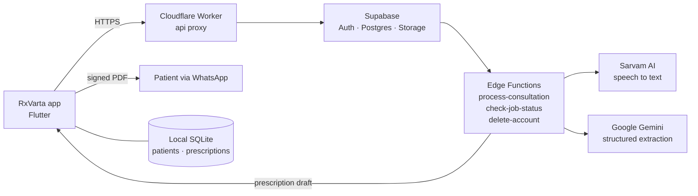

# RxVarta

**AI medical scribe for Indian outpatient clinics.** Consultation audio in, signed NMC-format prescription out.

[Website](https://rxvarta.com) · [Contact](mailto:varad@rxvarta.com)

---

> **Note:** RxVarta is a closed-source product. This repository documents the product, its architecture and my contributions to it.

## Overview

Doctors in Indian OPDs see dozens of patients a day and spend a large share of each visit writing prescriptions by hand. Most clinics have no EMR, no computer at the desk, and patients who speak Hindi, Odia, Tamil, Telugu or a mix of English and a regional language.

RxVarta is an Android and iOS app that listens to the consultation, transcribes it in the language it was spoken, and produces a structured prescription in the format the National Medical Commission (NMC) expects. The doctor reviews and signs it, and the patient receives it on WhatsApp before leaving the room.

The app is built on three rules:

1. **The AI only records what the doctor said.** It never suggests, infers or adds a medicine, dose or instruction.
2. **The doctor approves everything.** Every field is editable, and nothing is shared until the doctor signs.
3. **Patient records stay with the doctor.** Patient details and prescriptions are stored on the doctor's phone.

## How a consultation works

| Step | What happens |
| --- | --- |
| **1. Doctor profile** | On first launch the doctor signs in and sets up a profile: name, qualifications, NMC registration number, clinic name, address and phone. These appear on every prescription. |
| **2. Patient intake** | The doctor adds a new patient (name, age, gender, WhatsApp number) or picks an existing one. Recording cannot start until the patient's consent is recorded, as the DPDP Act requires. |
| **3. Recording** | The doctor picks the consultation language or leaves it on auto-detect, then records. A live waveform shows the mic is working. Recording can be paused and resumed, and it survives brief network drops. |
| **4. Transcription** | The audio is uploaded securely and transcribed by Sarvam AI, which handles Indian languages and code-mixed speech. Recordings under five minutes are processed in a single request. Longer ones run as a background job that the app checks on until it finishes. |
| **5. Structuring** | The transcript is turned into a structured draft using Google Gemini with a fixed JSON schema: symptoms, diagnosis, medicines (name, dosage, frequency, duration, timing relative to food), tests, instructions, advice and follow-up. A local ICD-10 lookup adds a code that only the doctor sees. |
| **6. Review** | Every section is editable. Medicines can be added, changed or removed, with undo. Changes are saved automatically. If processing fails, the doctor can fill the prescription in by hand. |
| **7. Sign and generate** | The doctor signs on screen and the app generates an NMC-format PDF with the doctor header, patient details, diagnosis, medicines table, instructions, advice, the next visit date and the signature. |
| **8. Share** | The prescription goes to the patient on WhatsApp, or through any other app. It is saved to the patient's history for later visits. |

On average a consultation is ready to review about 12 seconds after recording stops, at a processing cost of under ₹2.

## Features

**Clinical workflow**
- Patient list, search and visit history
- Consent capture before every recording
- 8 Indian languages, with auto-detect and code-mixed speech
- Structured prescriptions with food-timing chips (before food, after food, with food, empty stomach, before bed, as directed)
- Follow-up scheduling with the next visit date printed on the prescription
- NMC-format PDF with multi-page support for long medicine lists

**Accounts**
- Email and password or Google sign-in
- Email confirmation and password reset
- In-app account deletion that removes server data and everything stored on the phone

**Experience**
- Works on everyday Android phones, with no computer or EMR needed
- Light and dark mode
- App interface in several Indian languages
- Clear offline and error states, with a manual fallback when processing fails

## Architecture



- **Client:** The Flutter app holds all patient records in a local SQLite database (Drift). It never stores the AI provider keys.
- **Proxy:** All traffic goes through a Cloudflare Worker on RxVarta's own address. Some Indian ISPs block the default Supabase domain, and the proxy keeps the app working on every network.
- **Backend:** Supabase handles authentication, doctor profiles, job tracking and short-lived audio storage. TypeScript Edge Functions run the transcription and extraction pipeline and hold the API keys as server-side secrets.
- **AI:** Sarvam AI converts speech to text, and Google Gemini turns the transcript into a schema-validated JSON prescription.

## Privacy and compliance

| Area | Approach |
| --- | --- |
| Patient records | Stored on the doctor's device, not on RxVarta servers |
| Consultation audio | Uploaded over HTTPS for transcription, then deleted |
| Data location | Backend hosted in India (Mumbai) |
| Consent | Recorded before every consultation |
| Regulation | Designed around India's Digital Personal Data Protection Act, 2023 |
| Deletion | Doctors can delete their account and all of their data from the app |
| Secrets | API keys live only on the server. CI runs secret scanning on every pull request. |

## Tech stack

| Layer | Technology |
| --- | --- |
| Mobile | Flutter, Dart, Riverpod, go_router, Drift, freezed, dio |
| Backend | Supabase (Auth, Postgres, Storage, Edge Functions on Deno/TypeScript) |
| AI | Sarvam AI Saaras (speech to text), Google Gemini (structured extraction) |
| Edge | Cloudflare Workers |
| Documents | pdf, printing, share_plus |
| Email | Custom SMTP with branded templates |
| Quality | GitHub Actions (format, static analysis, 116 automated tests, APK build), gitleaks, Dependabot, end-to-end tests on recorded audio |

## Project structure

```
lib/
  app/          app shell, theme, routing
  core/         networking, configuration, shared utilities
  data/         local database and repositories
  domain/       data models
  features/     onboarding, home, patient, consultation, prescription, settings
supabase/
  functions/    process-consultation, check-job-status, delete-account
  migrations/   database schema
  email-templates/
cloudflare-proxy/   edge proxy for the API
```

## Status

RxVarta is in private beta with Indian clinics, and the Play Store release is in progress. It has been validated with practicing doctors in high-volume OPD, dental and eye care practices.

Clinics interested in early access can write to **varad@rxvarta.com**.

## Team

| Name | Role |
| --- | --- |
| **Varadraj Agrawal** | Founder · [LinkedIn](https://linkedin.com/in/varadrajagrawal) |
| **Vidhu Mahajan** | Co-founder, Engineering and Growth · [LinkedIn](https://linkedin.com/in/vidhumahajan) |

## My contributions

As co-founder, I work across engineering and growth. For the launch release I owned:

**Authentication and accounts**
- Email and Google sign-in, with clear error handling for wrong passwords, unconfirmed emails and duplicate accounts
- A password reset path, including for accounts first created with Google
- Custom SMTP and branded email templates for confirmation and reset

**Account deletion**
- The `delete-account` Edge Function, which removes the auth user, doctor profile, pipeline jobs and stored audio
- The in-app flow with typed confirmation. It wipes local data only after the server confirms, so nothing is lost if the network fails.

**Network reliability**
- Diagnosed an ISP-level block of the Supabase domain in India that stopped login for users on Jio and Airtel
- Built and deployed a Cloudflare Worker proxy and moved the app and email links onto it, at no extra infrastructure cost
- Added request timeouts, retries with backoff for long transcription jobs, and a manual entry fallback

**Release engineering**
- Release signing, app icon, Android 16 target and permission cleanup
- Removed inaccurate compliance claims and debug output from release builds
- Fixed the CI build pipeline for the Android release

**Legal and store readiness**
- Privacy policy, terms and account deletion pages that match how the app actually handles data
